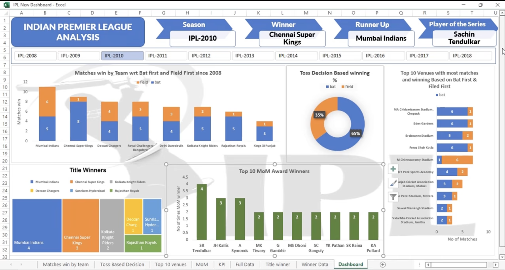

# ipl-match-performance-analysis-dashboard
An advanced sports analytics case study and interactive Excel dashboard examining IPL match outcomes, toss decision strategies, venue dominance, and player impact metrics from 2008 to 2018.

# 🏏 Indian Premier League (IPL) Match & Performance Analysis Dashboard (2008–2018)

## 📌 Project Overview

This project presents a comprehensive sports analytics case study and an interactive Excel dashboard examining Indian Premier League (IPL) matches from 2008 through 2018. The analysis explores captaincy toss decisions, venue-specific win probabilities, team dominance, and individual player impact (Man of the Match valuations).

---

## 📊 Dashboard Preview

---

## 🎯 Key Performance Metrics & Summary

* **Total Matches Analyzed:** 696 matches spanning 11 seasons (2008–2018).
  
* **Key Franchise Dynasties Tracked:** Mumbai Indians, Chennai Super Kings, Kolkata Knight Riders, and others.
  
* **Core Focus Areas:** Toss Decision Strategies, Fortress Venues, Player Impact, and Title Winner Transition Dynamics.
  
---

## 🔍 Core Problem Set & Analytical Framework

1. **Toss Decision Strategy Optimization:**
   - Evaluated match win percentages for teams choosing to bat first versus fielding first across all seasons.
     
   - Analyzed venue-specific biases (dew factor, pitch degradation) determining win probabilities.
     
2. **Team Match-Outcome Consistency & Venue Dominance:**
   
   - Ranked top 10 venues by total matches hosted and segmented match outcomes by strategy.
   - Identified "fortress venues" where specific franchises maintain abnormal win rates.
     
4. **Player Impact & Man of the Match (MoM) Valuation:**
   
   - Analyzed the distribution of MoM awards across marquee performers (e.g., Sachin Tendulkar, Chris Gayle, AB de Villiers) to measure individual contribution consistency.
     
6. **Season-on-Season Title Winner Transitions:**
   
   - Investigated macroeconomic factors in squad construction and retention policies separating perennial champions from struggling franchises.

---

## 🛠️ Tools & Technologies Used

* **Microsoft Excel:** Pivot Tables, Advanced Slicers, Timeline filters, Dynamic UI Design, and Interactive Charting.
  
* **Sports Analytics Frameworks:** Toss strategy optimization, venue bias modeling, and performance valuation.
  
* **GitHub:** Version control and professional portfolio hosting.

---

## 📂 Repository Structure

* `IPL Dataset.xlsx` - Primary dataset containing match-by-match results, venues, toss decisions, and winner details.
  
* `IPL Dataset Problem Statements & Business Case.pdf` - Official problem statement guidelines and analytical questions.
  
* `Dashboard Screenshot` - Visual preview of the Excel dashboard interface.
  

---
